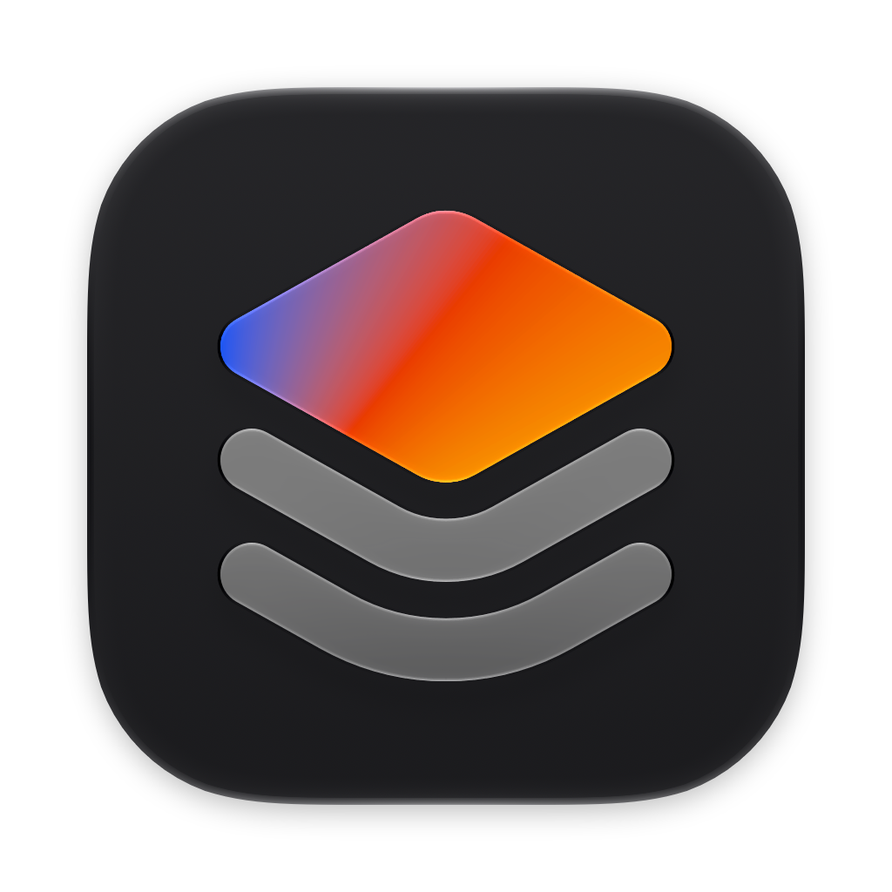
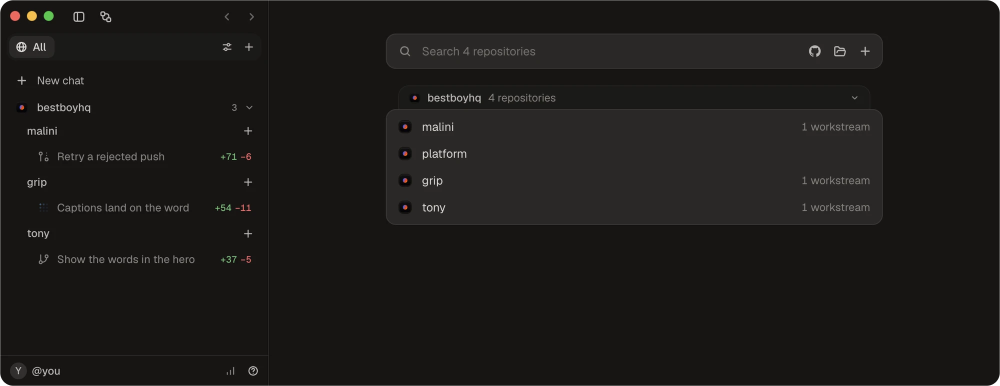
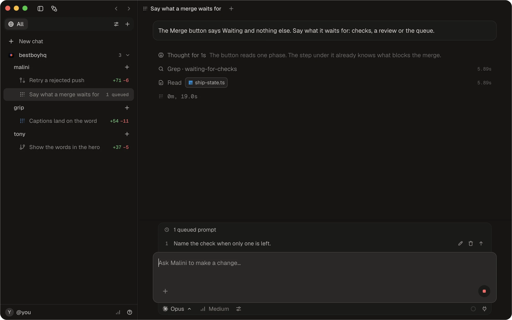
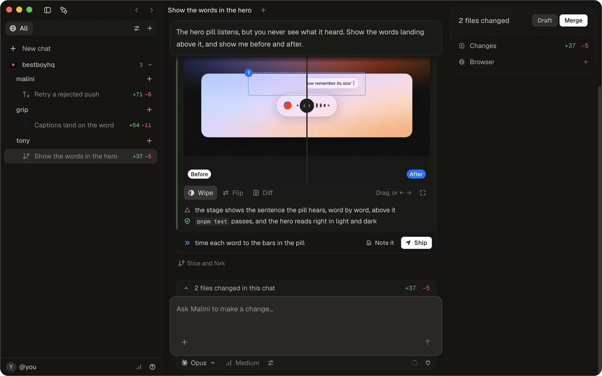
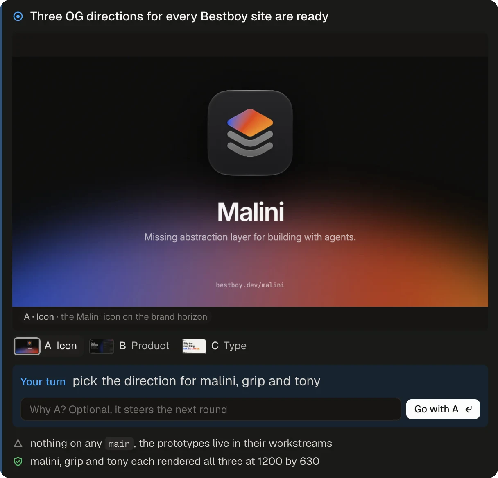
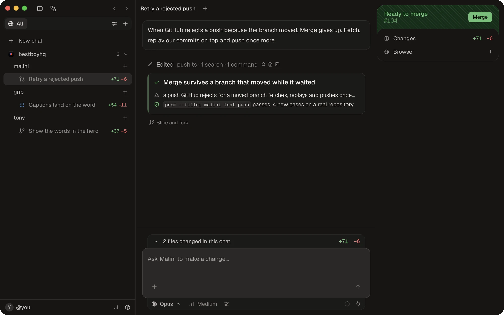
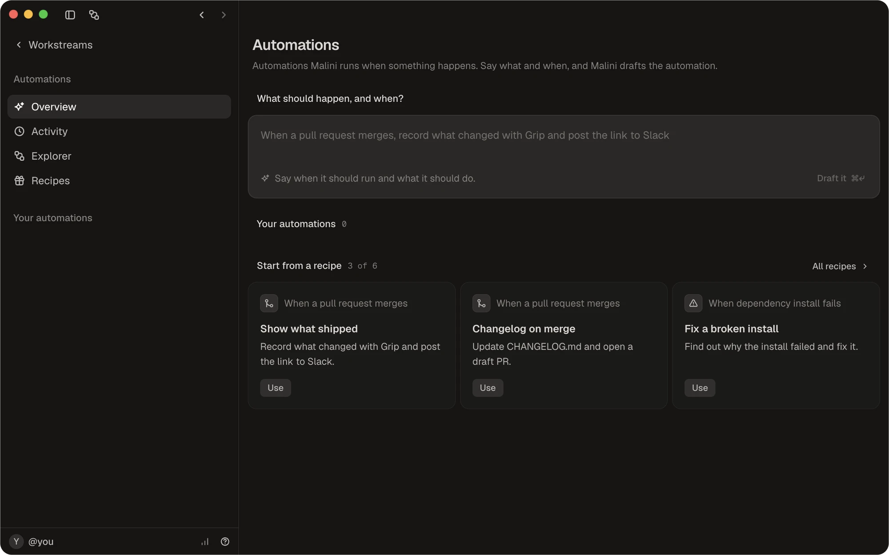
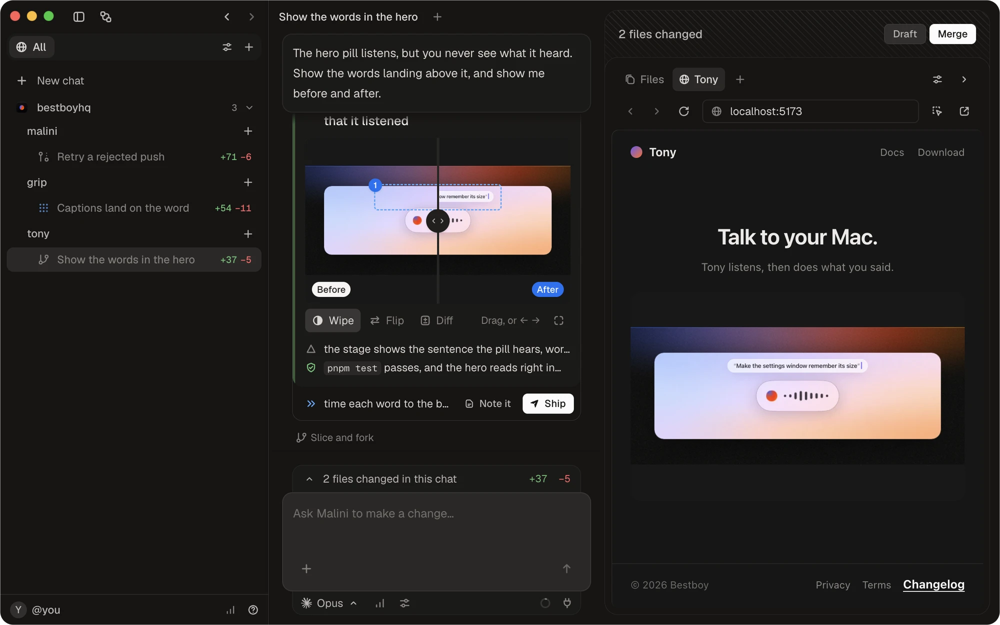

<p align="center">
  
</p>

<h1 align="center">Malini</h1>

<p align="center">
  <b>Missing abstraction layer for building with agents.</b><br>
  Run as many Claude Code agents as you want, each in its own worktree.<br>
  Malini does the git, the pull requests and the red checks. You read reports and press Merge.<br>
  Free and open source macOS app.
</p>

<p align="center">
  <a href="https://github.com/bestboyhq/malini/releases/latest/download/malini-arm64.dmg"></a>
</p>

<p align="center">
  <a href="https://github.com/bestboyhq/malini/releases/latest"></a>
  
  <a href="LICENSE"></a>
</p>

<p align="center">
  <picture>
    <source media="(prefers-color-scheme: light)" srcset=".github/readme/hero-light.webp">
    
  </picture>
</p>

---

## What is Malini?

Malini is a Mac app that runs your own Claude Code, many agents at once.
Every task is a workstream: its own git worktree, its own branch, its own chats.
Start one or a hundred.

One agent in one terminal is easy.
Ten agents mean ten checkouts, ten branches and ten pull requests, and you are the one who keeps them apart.
Malini keeps them apart, and does the git: agents write the code, Malini commits, pushes, opens the pull request and merges it.

A turn does not end in a wall of text.
It ends in a report: a picture, what changed, and how it was checked.

| Malini takes the place of                | With                                                                                       |
| ---------------------------------------- | ------------------------------------------------------------------------------------------ |
| A terminal tab per agent                 | A sidebar of workstreams that says which one runs, which one is done, and which needs you. |
| Your `git worktree` scripts              | A fresh worktree, a branch and installed dependencies, one click per task.                 |
| Reading a transcript to see if it worked | A report with a screenshot, before and after, and the check that passed.                   |
| Watching a pull request go red           | **Merge**. Malini fixes checks, merges main in, answers review, and merges.                |
| Cron jobs and saved prompts              | Automations that run on an event, on a schedule, or when you ask.                          |
| An API key pasted into a chat            | Secrets the agent asks for by name. Your keychain keeps them.                              |

---

# Core features

## One task, one worktree

Press **+** on a repository and the task gets a fresh worktree, its own branch, and dependencies installed from the lockfile.
Two agents never share a checkout, so neither one wins.
Agents can't commit, push, rebase, reset or run `gh pr create`: Malini owns git.

<p align="center">
  
</p>

## Queue the next prompt, or steer now

A new prompt does not kill the run in flight.
**↵** queues it after the run, and **⌘↵** steers the agent now.
Edit, reorder or delete what waits in the queue.

<p align="center">
  
</p>

## Every turn ends in a report

A report is a picture, one line on what changed, and one line on how it was checked.
A visible change comes with before and after, and every changed area gets a number, including the ones nobody meant to change.
What the agent left for later sits under it, one click from being the next prompt.

<p align="center">
  
</p>

## Ask for options, pick one

An open question comes back as two to four variants, not one guess.
You pick, say why if you like, and the agent builds the winner.
The rest never touch your code.

<p align="center">
  
</p>

## Press Merge and walk away

**Draft** commits, pushes and opens the pull request, with a title in your repository's convention.
**Merge** queues it: Malini fixes red checks, merges main in, resolves conflicts and answers review.
It merges exactly the commit that passed, and the workstream archives itself when it lands.

<p align="center">
  
</p>

## Automate what you ask twice

An automation is work you reuse by name: instructions, a model, an effort, and only the skills it needs.
Say what should happen and when, and Malini drafts it.
You run it, an event runs it, or a schedule does, and a Then runs next, so "update the changelog, then open a draft" is one automation.

<p align="center">
  
</p>

## The agent tests it in a browser

Browser tabs sit in the inspector, next to your files.
The agent opens the page, clicks, types and takes the screenshot its report shows.
Pick an element on the page and it lands in your prompt.

<p align="center">
  
</p>

## Secrets by name, never in the chat

When a command needs an API key, the agent asks for it by name on a card in the chat.
You paste it once, and your Mac's keychain keeps it for that repository.
The agent's commands read it as `$NAME`, and every output shows `[secret]`.

---

# All features

### Workstreams

- A fresh worktree and branch per task, from a private clone of the repository
- Dependencies installed from the lockfile: pnpm, npm, yarn or bun
- Many chats per workstream, as tabs, named for you
- A sidebar with lines changed, unread marks, queued prompts and pull request status
- What keeps running on each workstream: dev servers and Docker services, each with a stop button
- A port of its own per workstream for every name in `.malini/workspace.json`
- A chat in one repository starts workstreams in the others and hears their reports
- Archive a workstream and restore it, or save it for later
- A scratchpad of ideas per repository
- Any repository from **⌘K**, GitHub, or a folder on your Mac
- Open a workstream in your editor, or reveal it in Finder

### Chat

- **↵** queues a prompt, **⌘↵** steers the run
- Plan mode writes the plan, then **Implement plan** starts the work
- A model and an effort per prompt, from Low to Max
- **Auto**, **Sandboxed** or **Full access**, and approvals once, per chat or per workstream
- A macOS sandbox around every agent command and every install
- Thinking shown step by step, with a diff for every file the chat changed
- One line per subagent, its steps and report one click away
- **@** mentions a file
- Attach, paste or drop images, GIFs, recordings and files, up to 100 MB each
- **Run** on a shell code block runs it in the workstream, and the agent reads its output
- Undo any run, edit an earlier message, or slice and fork into a new chat
- Runs that a restart cut short pick up where they left off
- A sound you pick when an agent finishes, and another when it needs you
- **Keep working with the lid closed**, until the agents are done or the battery is at 5%

### Reports

- Three sizes: a screenshot and one line, up to three points, or the full write-up
- Before and after as Wipe, Flip or Diff, with every changed area numbered
- Two to four variants for an open question, as pictures, recordings or live pages
- A **Your turn** line when the agent is blocked on you, and only then
- Next steps with **Ship** and **Note it**
- The commit subject and the pull request title, in your repository's convention

### Shipping

- **Draft** opens a draft pull request, **Merge** queues it
- **Fix checks**, **Update from main**, **Resolve conflicts** and **Address review** run on their own
- Review threads answered and resolved once fixed
- The merge names the commit that passed, so GitHub merges nothing else
- Main merged in when it reaches a file the workstream changed
- A failing step says why, with what GitHub said and **Retry now**
- **Needs you** only when it does: a question for you, a blocked merge, an expired sign-in
- Checks, changes and review in the top bar
- **Reopen** for a pull request closed on GitHub

### Automations

- A name, instructions, a model, an effort, and the skills it loads
- A When: you, any event Malini emits, or a schedule like `every weekday at 09:00`
- A trigger that is **Off**, **Ask me first** or **On its own**
- A Then: the automation that runs next, **Open draft** and **Merge** included
- Fourteen built in, and yours to edit
- Recipes to start from
- **/** in the composer runs one from a chat
- A suggestion when you type the same thing after two merges
- The agent lists, saves and runs automations, and saving one waits for you
- An event log, and an Explorer that draws what started what

### Browser and agent tools

- Browser tabs in the inspector, yours and the agent's
- The agent opens, clicks, types, uploads and takes screenshots
- Pick an element and it lands in your prompt
- Secrets by name, sealed in your keychain, masked in every output
- A file only you may write opens in a tab beside the chat
- Agents start workstreams, clone repositories and run automations with Malini's own tools

### Models and usage

- Fable, Opus, Sonnet or Haiku on your Claude plan
- DeepSeek and OpenCode models on their own key
- GPT models on your ChatGPT plan
- The context window and your plan usage, one click from the composer
- Several Claude accounts, switched in one click
- MCP servers turned on or off for every open chat at once

### Skills and extensions

- Skills ranked by use, with last use, token cost and an on/off switch
- An automation loads only the skills it names
- A marketplace of extensions, installed without Claude Code's plugin commands
- An inspector built from extensions: files, diffs, the tree and todos
- Publish your own from a repository with a `malini.json`

### Second brain

- What you typed in your chats lands in a log, in a private repository of yours
- A weekly automation turns the log into notes by topic
- Read them on the Brain page, or open the folder in Obsidian

### Stats

- Memory and CPU for Malini, its agents, their tools, browser tabs and Docker
- Runs today, your streak and six months of activity, counted on your Mac
- Share cards, copied as a picture
- A public profile at bestboy.dev, if you want one

### Privacy

- No account, no subscription, no Malini server
- Usage stats that one switch turns off
- Streamer mode masks email addresses and your user name while you record or stream

The [docs](https://bestboy.dev/malini/docs) explain each one.

---

# Install

[Download Malini](https://github.com/bestboyhq/malini/releases/latest/download/malini-arm64.dmg) and drag it to Applications.
It needs macOS 13 or later on Apple silicon, and git.
Malini ships the GitHub CLI, installs Claude Code if this Mac lacks it, and updates itself.

On the first launch, setup signs you in to GitHub with a one-time code in your browser.
It ends on your five latest repositories, under **What are we working on?**
Pick one and Malini clones it and starts a workstream in it.

# Use

## Start a task

1. Press **+** on a repository, or **⌘N**.
2. Say what you want.
3. Press **↵**.

## Keep it moving

1. Press **↵** to queue the next prompt, or **⌘↵** to steer the run.
2. Read the report when the turn ends.
3. Press **Ship** on a next step to send it back as the next prompt.

## Ship it

1. Press **Draft** to open a draft pull request.
2. Press **Merge**.
3. Start the next task. Malini says **Needs you** if it does.

Every [key](https://bestboy.dev/malini/docs/chat#keys) is in the docs.

---

# It does not go wrong

You have seen each of these with agents in a terminal.
Malini rules them out instead of asking the agent nicely.

| The usual accident                                       | How Malini rules it out                                                                                       |
| -------------------------------------------------------- | ------------------------------------------------------------------------------------------------------------- |
| Two agents edit one checkout                             | Every workstream is its **own git worktree**, on its own branch.                                              |
| An agent commits half-done work, or opens a pull request | The agent bridge **refuses commit, push, rebase, reset and `gh pr create`**. Malini owns the history.         |
| The merge lands a commit nobody checked                  | Malini merges with `--match-head-commit`, so GitHub merges **exactly the commit that passed**.                |
| A malicious package reads your credentials               | Agent commands and installs run in a **macOS sandbox** that cannot read them or write outside the workstream. |
| An API key ends up in a transcript                       | Keys live in the **keychain**, and every output shows `[secret]`.                                             |
| Two dev servers fight over port 5173                     | Each workstream **leases its own port** for every name the repository lists.                                  |
| A run "finishes" while its dev server still runs         | A run **stays open** while its background commands and agents run, and you can stop each one.                 |
| Quitting the app loses the work in flight                | Runs that a restart cut short **pick up where they left off**.                                                |
| One bad turn wrecks the branch                           | Every run has **Undo**.                                                                                       |

# Why open source

The best AI coding tools are closed source, and they answer to investors.
Prices change.
Limits change.
Features go away.
Malini is the other way.

- **Open source, so we can't rug pull you.**
  The code is public under AGPL, with no account, no subscription and no Malini server.
  If we ever go wrong, fork it.
- **On your side of the token.**
  An AI lab earns more when you use more tokens, and Malini earns nothing from them.
  It shows your context window and your plan usage, and you pick the model and the effort for every prompt.
- **Written down.**
  Every big decision is in [`docs/adr`](docs/adr), one file each.

# Private by design

Your code leaves your Mac only through your own Claude Code, to Anthropic or the provider you pick, and through the GitHub CLI, to GitHub.
Malini makes twelve calls of its own.

| Malini calls              | When                                                     | For                                                  |
| ------------------------- | -------------------------------------------------------- | ---------------------------------------------------- |
| GitHub Releases           | In a release build                                       | Update checks                                        |
| Logdash, stored in the EU | Until you turn off **Share usage stats**                 | Counts and error names, never code, prompts or paths |
| GitHub                    | This Mac lacks a working GitHub CLI                      | The GitHub CLI, checked against its checksum         |
| Anthropic                 | This Mac lacks Claude Code                               | Claude Code, checked against its checksum            |
| models.dev                | At launch, and as you open the model picker              | The model lists of DeepSeek and OpenCode             |
| opencode.ai               | You save an OpenCode key                                 | One-token messages that tell which plan the key runs |
| opencode.ai               | You use an OpenCode Go key                               | That key's usage                                     |
| DeepSeek or OpenCode      | You run a chat on their key                              | The chat, passed on with your key                    |
| bestboy.dev               | Extensions or Profile is open, or something is installed | The extension marketplace                            |
| bestboy.dev               | You turn on **Publish my stats**                         | The numbers on your profile                          |
| bestboy.dev               | You turn on a project in Settings, Profile               | Its link, its runs per day and its changelog         |
| OpenAI                    | You sign in with ChatGPT                                 | The GPT models your plan runs                        |

While you are signed in to Bestboy, each usage count carries your account, as a hash made on your Mac.
Signed out, it carries a random ID made for this install, and turning stats off deletes it.
[Exactly what Malini sends](https://bestboy.dev/malini/docs#where-your-code-goes).

# How it works

Malini is built on three rules.

- **Your Claude Code, as you left it.**
  Malini drives the `claude` on your Mac through the Claude Agent SDK, with your plan, your `CLAUDE.md`, your skills and your MCP servers.
- **Malini owns git.**
  Agents leave changes in the working tree, and Malini makes every commit, push, pull request and merge.
- **Everything is an event.**
  A finished turn, a failed check and a merged pull request are events in one log, and automations run on them.

The stack: Electron and Svelte 5 for the app, the Claude Agent SDK for the agents, SQLite for what Malini keeps, and the `gh` CLI for GitHub.
There is no backend service and no cloud.

# Build from source

You need macOS on Apple silicon and Node 24.

```sh
git clone https://github.com/bestboyhq/malini && cd malini
corepack enable pnpm   # once; the repository pins pnpm 12
pnpm install
pnpm dev               # the app, with hot reload
pnpm check             # types and the command and event contract
pnpm test:e2e          # builds, then Playwright drives the app
```

# Contributing

Issues and pull requests are welcome.
Malini is built in Malini.
Read [AGENTS.md](AGENTS.md) for the layout and the conventions, and [`docs/adr`](docs/adr) for why it is built this way.
Pull request titles follow [Conventional Commits](https://www.conventionalcommits.org), and every merged `feat`, `fix` or `perf` ships to users as an in-app update.
Before your first pull request is merged, you sign the [Contributor License Agreement](CLA.md) by commenting on the pull request as the CLA bot asks.

Malini is a sibling of [Grip](https://bestboy.dev/grip), the free and open source screen recorder, and [Tony](https://bestboy.dev/tony), free and open source dictation for the Mac.

# License

Copyright (C) 2026 Szymon Grącki and Malini contributors

Licensed under [AGPL-3.0-only](LICENSE).
`packages/extension-api` is licensed under [MIT](packages/extension-api/LICENSE), so an extension can use any license.

Additional permission under GNU AGPL version 3 section 7: if you modify this program, or any covered work, by linking or combining it with the Claude Agent SDK (`@anthropic-ai/claude-agent-sdk`, or a modified version of that library), containing parts covered by the terms of Anthropic's license for that SDK, the licensors of this program grant you additional permission to convey the resulting work.

Additional term under GNU AGPL version 3 section 7(e): the license grants no rights to the Malini and Best Boy names and logos, which [TRADEMARKS.md](TRADEMARKS.md) covers.

Third-party components and their notices are listed in [NOTICE](NOTICE).

Contributions require signing the [Contributor License Agreement](CLA.md); the CLA bot asks on your first pull request.

Claude, Claude Code and the Claude logo are trademarks of Anthropic, PBC.
Third-party names and logos are not covered by this license and appear only to identify those products.
