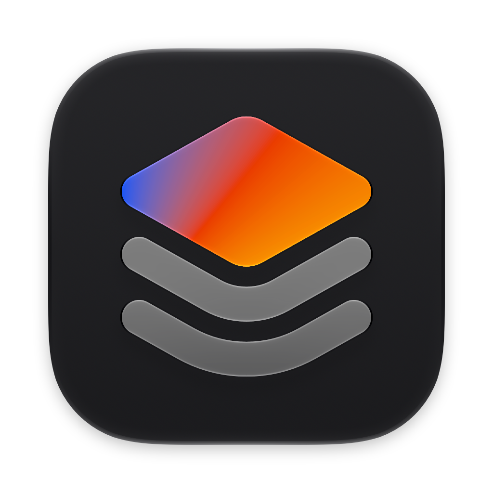
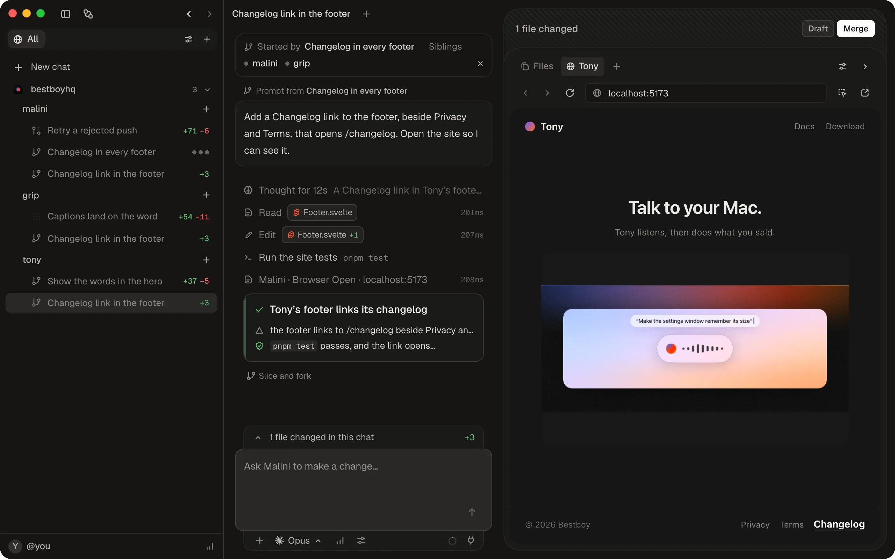
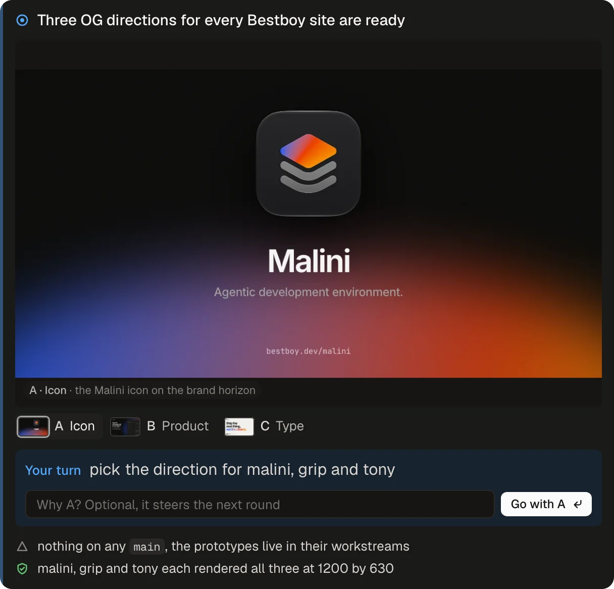
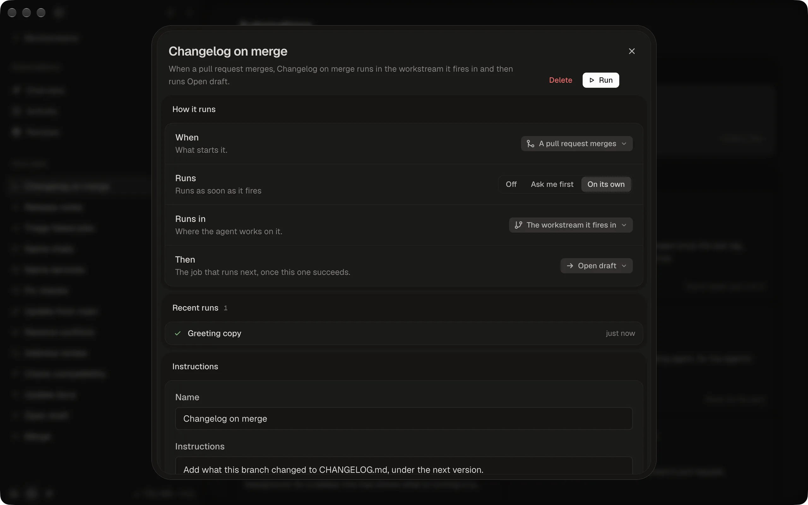

<p align="center">
  
</p>

<h1 align="center">Malini</h1>

<p align="center">
  <b>Agentic development environment for builders moving fast.</b><br>
  Run as many Claude Code agents as you want, each in its own worktree.<br>
  Malini does the git, the pull requests and the red checks. You read reports and press Merge.<br>
  Free and open source macOS app.
</p>

<p align="center">
  <a href="https://github.com/bestboyhq/malini/releases/latest/download/malini-arm64.dmg"></a>
</p>

<p align="center">
  <a href="https://github.com/bestboyhq/malini/releases/latest"></a>
  
  <a href="LICENSE"></a>
</p>

<p align="center">
  
</p>

---

## What it fixes

| You have seen this                                                         | What Malini does                                                                                                           |
| -------------------------------------------------------------------------- | -------------------------------------------------------------------------------------------------------------------------- |
| Two agents share one checkout. One of them wins.                           | Every task is a workstream: its own git worktree, branch and chats. Start one or a hundred.                                |
| An agent commits half-done work and opens a pull request you never wanted. | Agents can't commit, push, rebase, reset or run `gh pr create`. Malini owns git.                                           |
| A new prompt kills the run in flight.                                      | **↵** queues it after the run. **⌘↵** steers now.                                                                          |
| A turn ends in a wall of text.                                             | Every turn ends in a report: a picture, one line on what changed, one on how it was checked.                               |
| "Fixed the layout." Sure.                                                  | A visible change comes with before and after. Every changed area gets a number, including the ones nobody meant to change. |
| You asked for a design and got one guess.                                  | An open question comes back as two to four variants. You pick, the agent builds the winner.                                |
| The pull request sits red overnight.                                       | Press **Merge**. Malini fixes checks, merges main in, answers review, and merges exactly the commit that passed.           |
| One change spans three repositories.                                       | A chat in one repository starts a workstream in each of the others, and hears their reports.                               |
| You type the same prompt every Monday.                                     | Make it an automation. Give it a trigger, like a merged pull request, and a Then, like **Open draft**.                     |
| The agent wants your API key in the chat.                                  | It asks for the key by name. Your keychain keeps it, and every output shows `[secret]`.                                    |
| One bad turn wrecks the branch.                                            | Every turn has Undo. Or fork the chat and try again.                                                                       |

<p align="center">
  
</p>

<p align="center">
  <sub>Ask for options and pick one. The rest never touch your code.</sub>
</p>

Everything else Malini does is in [`docs/features.md`](docs/features.md) and the [docs](https://bestboy.dev/malini/docs).

## How it works

1. **Start a task.**
   Press **+** on a repository, or ask a chat to start workstreams in the other repositories a change touches.
   Each one gets a fresh worktree, its own branch, and dependencies installed from the lockfile.
2. **Keep it moving.**
   Queue prompts, plan first, and pick the model and effort for every prompt.
   Agents write the code and test it in a browser tab beside your files.
3. **Press Draft, then Merge.**
   Malini commits, opens the pull request, fixes red checks, answers reviews, and merges once GitHub allows.
   The workstream archives itself when it lands.

## Automations

An automation is work you reuse by name: instructions, a model, an effort, and only the skills it needs.
You run it, an event runs it, or a schedule does, like `every weekday at 09:00 in bestboyhq/malini`.
A Then runs next, so "update the changelog, then open a draft" is one automation.
Ten come built in, among them **Fix checks**, **Update from main**, **Resolve conflicts** and **Address review**, and they are yours to edit.
Type the same prompt often enough and Malini offers to make it an automation.

<p align="center">
  
</p>

## Why open source

The best AI coding tools are closed source, and they answer to investors.
Prices change.
Limits change.
Features go away.
Malini is the other way.

**Open source, so we can't rug pull you.**
The code is public under AGPL.
No account, no subscription, no Malini server.
If we ever go wrong, fork it.

**Transparent, all the way down.**
Your code leaves your Mac only through your own Claude Code, to Anthropic or the provider you pick, and through the GitHub CLI, to GitHub.
Malini makes seven calls of its own: update checks, usage stats you can turn off, which carry your Bestboy account while you are signed in, model lists from models.dev, one-token checks against opencode.ai when you save an OpenCode key, the extension marketplace while you use it, your stats to a public profile, only if you publish them, and OpenAI, only after you sign in with ChatGPT, for the GPT models your plan runs.
Every big decision is written down in [`docs/adr`](docs/adr).

**On your side of the token.**
An AI lab earns more when you use more tokens.
Malini earns nothing from them.
It shows your context window and your plan usage, and you pick the model and the effort for every prompt.
Claude Code loads every skill you own into every chat: with 47 skills, that is about 7,400 tokens before you type a word.
Malini ranks them by how often your agents use them, so you turn off the ones no chat needs.

## Install

1. [Download Malini](https://github.com/bestboyhq/malini/releases/latest/download/malini-arm64.dmg) and drag it to Applications.
2. Open it.
   Setup installs Claude Code if this Mac lacks it, and signs you in to GitHub with a one-time code in your browser.
3. Setup ends on your five latest GitHub repositories, under **What are we working on?**
   Pick one and Malini clones it and starts a workstream in it.

You need macOS 13 or later on Apple silicon, and git.
Malini ships the GitHub CLI.
Agents run your own Claude Code: Fable, Opus, Sonnet or Haiku on your Claude plan, or a DeepSeek or OpenCode model on its own key.
Malini updates itself.

The docs are at [bestboy.dev/malini/docs](https://bestboy.dev/malini/docs).
Every page is plain markdown at its URL plus `.md`, and [llms-full.txt](https://bestboy.dev/malini/llms-full.txt) holds all of them, so your agent can read them too.

## Build from source

You need macOS on Apple silicon and Node 24.

```sh
git clone https://github.com/bestboyhq/malini && cd malini
corepack enable pnpm   # once; the repository pins pnpm 12
pnpm install
pnpm dev               # the app, with hot reload
pnpm check             # types and the command and event contract
pnpm test:e2e          # builds, then Playwright drives the app
```

Malini is built in Malini.
Read [AGENTS.md](AGENTS.md) for the layout and the conventions, and [`docs/adr`](docs/adr) for why it is built this way.
Issues and pull requests are welcome; your first pull request asks you to sign the [CLA](CLA.md).
Pull request titles follow [Conventional Commits](https://www.conventionalcommits.org), and every merged `feat`, `fix`, or `perf` ships to users as an in-app update.

Malini is a sibling of [Grip](https://bestboy.dev/grip), the free and open source screen recorder, and [Tony](https://bestboy.dev/tony), free and open source dictation for the Mac.

## License

Copyright (C) 2026 Szymon Grącki and Malini contributors

Licensed under [AGPL-3.0-only](LICENSE).
`packages/extension-api` is licensed under [MIT](packages/extension-api/LICENSE), so an extension can use any license.

Additional permission under GNU AGPL version 3 section 7: if you modify this program, or any covered work, by linking or combining it with the Claude Agent SDK (`@anthropic-ai/claude-agent-sdk`, or a modified version of that library), containing parts covered by the terms of Anthropic's license for that SDK, the licensors of this program grant you additional permission to convey the resulting work.

Additional term under GNU AGPL version 3 section 7(e): the license grants no rights to the Malini and Best Boy names and logos, which [TRADEMARKS.md](TRADEMARKS.md) covers.

Third-party components and their notices are listed in [NOTICE](NOTICE).

Contributions require signing the [Contributor License Agreement](CLA.md); the CLA bot asks on your first pull request.

Claude, Claude Code and the Claude logo are trademarks of Anthropic, PBC.
Third-party names and logos are not covered by this license and appear only to identify those products.
