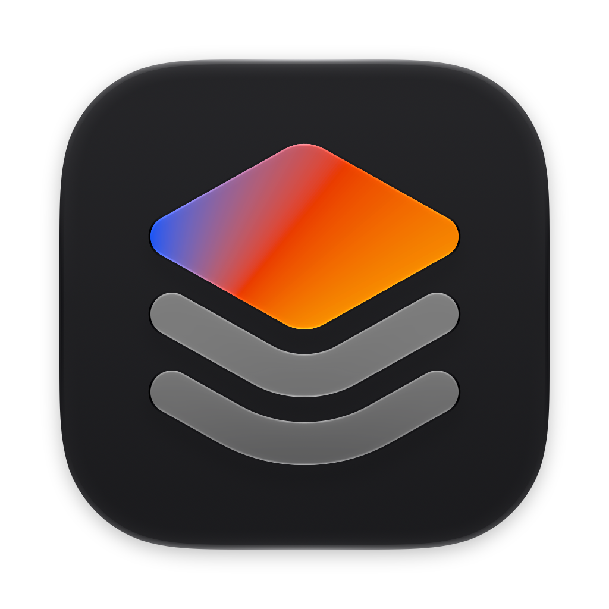
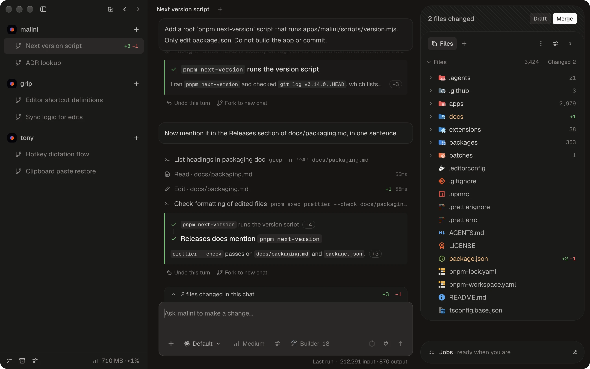
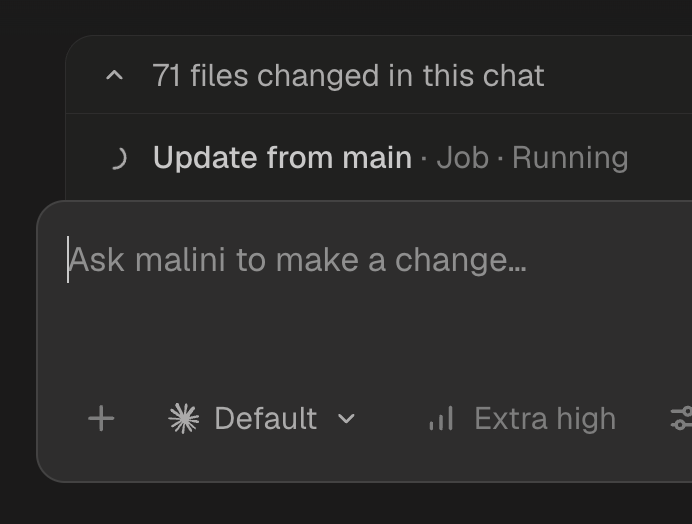

<p align="center">
  
</p>

<h1 align="center">Malini</h1>

<p align="center">
  <b>Agents write the code. Malini does the git.</b><br>
  An agentic development environment. Run many agents at once and come back to merged pull requests. Runs on Claude Code today.<br>
  Free and open source, for the Mac.
</p>

<p align="center">
  <a href="https://github.com/bestboyhq/malini/releases/latest/download/malini-arm64.dmg"></a>
</p>

<p align="center">
  <a href="https://github.com/bestboyhq/malini/releases/latest"></a>
  
  <a href="LICENSE"></a>
</p>

<p align="center">
  
</p>

---

## Why it exists

The best AI coding tools are closed source.
They belong to companies with investors to answer to, and when the two of you disagree, the investors win.
Prices change.
Limits change.
Features go away.
You can't look inside, and you can't take your setup with you.

Malini is the other way.

**Open source, so we can't rug pull you.**
The code is public under AGPL.
There is no account, no subscription and no Malini server.
We can't take it back, and if we ever go wrong, you can fork it.

**Transparent, all the way down.**
Your code goes to Anthropic through your own Claude Code, and to GitHub through the GitHub CLI.
That's it.
Malini makes two calls of its own: update checks, and anonymous usage data you can turn off.
Every big decision is written down in [`docs/adr`](docs/adr).

**On your side of the token.**
An AI lab earns more when you use more tokens.
It has no reason to help you use fewer.
Its interest and yours point in opposite directions.
Malini earns nothing from tokens.
It shows your context window and your plan usage, and you pick the model and the effort for every prompt.
Claude Code also loads every skill you own into every chat.
With 47 skills that is about 7,400 tokens before you type a word.
Malini groups skills into presets, so a chat loads only the skills its work needs, and the composer shows which.

**Outcomes, not skills.**
You never wanted skills.
A skill is a pile of markdown files, and that's an implementation detail.
What you wanted was the outcome: checks green, branch up to date, review answered.
So Malini has jobs.
A job is an outcome you ask for by name, and you can have as many as you like.
Give a job a skill preset, and it loads only the skills it needs.
That leaves your time for the work that matters, instead of fighting your setup.

<p align="center">
  
</p>

<p align="center">
  
</p>

<p align="center">
  <sub>A job running inside a chat.</sub>
</p>

## How it works

1. **Start a task.**
   Each task is a workstream: its own git worktree, its own branch, its own chats.
   Start one or start a hundred.
2. **Keep it moving.**
   Queue prompts, run jobs, plan first if you like.
   Agents write code, and Malini owns git.
3. **Press Draft, then Merge.**
   Malini commits, opens the pull request, fixes red checks, addresses reviews, and merges once GitHub allows.

Everything Malini can do is in [`docs/features.md`](docs/features.md).

## Install

1. [Download Malini](https://github.com/bestboyhq/malini/releases/latest/download/malini-arm64.dmg) and drag it to Applications.
2. Open it.
   Setup connects Claude Code and GitHub: **Install** and **Sign in** for Claude Code, and a one-time code in your browser for GitHub.
3. Add a repository.
   Your first workstream is ready.

You need macOS 13 or later on Apple silicon, and git.
Malini ships the GitHub CLI, and setup installs Claude Code if you don't have it.

## Build from source

You need macOS on Apple silicon and Node 24.

```sh
git clone https://github.com/bestboyhq/malini && cd malini
corepack enable pnpm   # once; the repository pins pnpm 12
pnpm install
pnpm dev               # the app, with hot reload
```

Read [AGENTS.md](AGENTS.md) for the layout and the conventions.
Issues and pull requests are welcome.
Pull request titles follow [Conventional Commits](https://www.conventionalcommits.org), and every merged `feat`, `fix`, or `perf` ships to users as an in-app update.

Malini is a sibling of [Grip](https://github.com/bestboyhq/grip), the free and open source screen recorder, and [Tony](https://github.com/bestboyhq/tony), free and open source dictation for the Mac.

## License

Copyright (C) 2026 Szymon Grącki and Malini contributors

Malini is licensed under [AGPL-3.0-only](LICENSE).
`packages/extension-api` is licensed under [MIT](packages/extension-api/LICENSE), so an extension can use any license.

Additional permission under GNU AGPL version 3 section 7: if you modify this program, or any covered work, by linking or combining it with the Claude Agent SDK (`@anthropic-ai/claude-agent-sdk`, or a modified version of that library), containing parts covered by the terms of Anthropic's license for that SDK, the licensors of this program grant you additional permission to convey the resulting work.

Claude, Claude Code and the Claude logo are trademarks of Anthropic, PBC.
Third-party names and logos are not covered by this license and appear only to identify those products.
