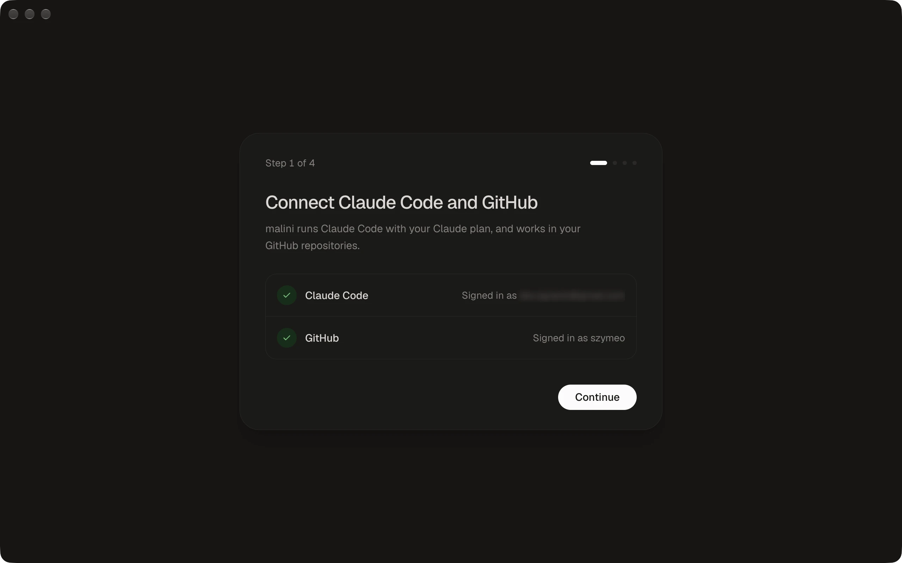
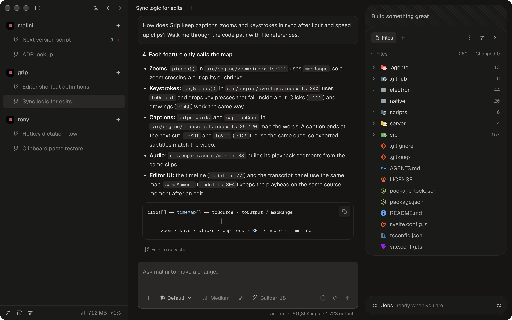
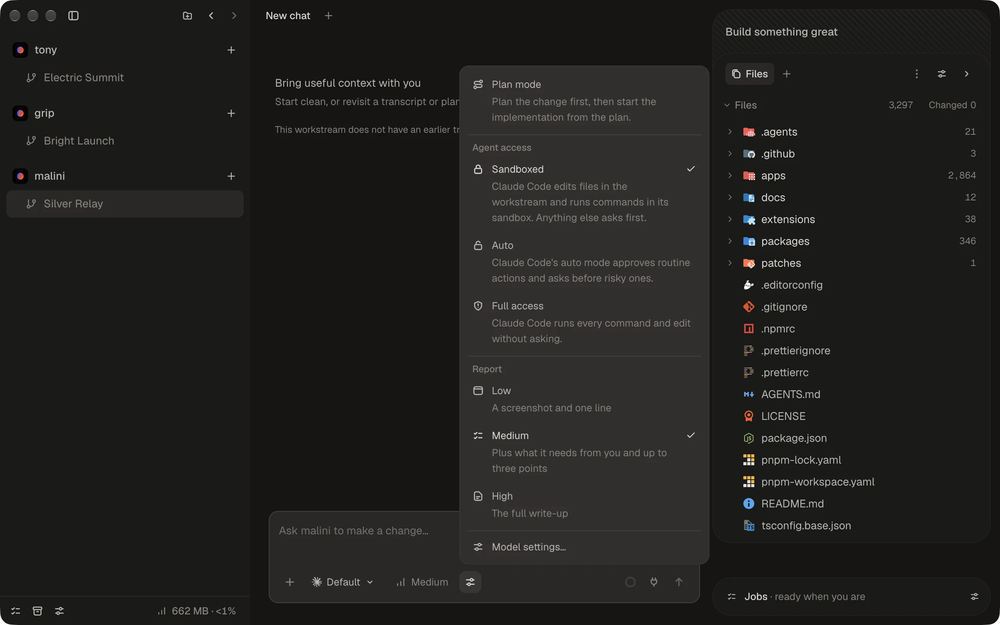
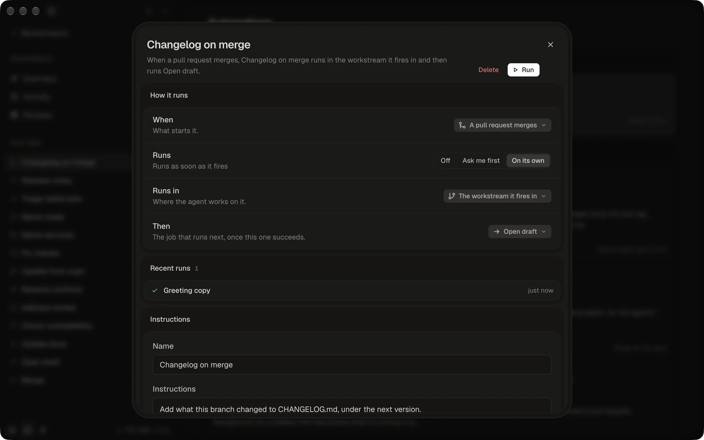

# Features

Everything Malini does, in one place.
The [README](../README.md) has the short version.

## Made for many agents at once

| The problem                                                              | What Malini does                                                                                                                                                                |
| ------------------------------------------------------------------------ | ------------------------------------------------------------------------------------------------------------------------------------------------------------------------------- |
| Two agents edit one checkout and clobber each other                      | Every workstream is its own **git worktree** on `malini/<id>`, or on your pull request's own branch, from a private clone of the repository.                                    |
| An agent commits half-done work or opens a pull request you never wanted | The agent bridge **refuses commit, push, rebase, reset, and `gh pr create`**. Malini owns the history.                                                                          |
| A new prompt kills the run in flight                                     | **↵ queues** the prompt after the current run. **⌘↵ steers** it now.                                                                                                            |
| A run "finishes" while its dev server and subagents still work           | A run **stays open while its background commands and agents run**, and you can stop each one.                                                                                   |
| A finished workstream looks busy because its dev server still runs       | The row says **Ready** as soon as the turn ends, and a second line names **what keeps running**: dev servers and Docker services. Hover it for ports and a stop button.         |
| One bad turn wrecks the branch                                           | Every run has **Undo**. Edit an earlier message to resend from there, or **fork to a new chat**, even mid-run.                                                                  |
| You can't tell whether a turn is really done                             | Every turn ends with a report: **Done**, **Done with something deferred**, or **Waiting on you**, with what changed, what was verified, and the commit and pull request titles. |
| You come back to ten agents and can't tell which one needs you           | Every turn ends with a **Your turn** list, unread workstreams are marked, and a chime and a notification tell you a run finished.                                               |
| The pull request sits red for hours                                      | The merge queue runs **Fix checks**, **Update from main**, and **Address review** until it merges, and says **Needs you** only when it must.                                    |
| The merge lands a commit nobody checked                                  | Malini merges with `--match-head-commit`, so GitHub merges **exactly the commit that passed**.                                                                                  |
| Quitting the app halfway through a run loses the work in flight          | Runs that a restart cut short **pick up where they left off** the next time Malini opens.                                                                                       |

## First launch

  

- **Both accounts, side by side.** Setup connects Claude Code and GitHub one at a time: **Install** and **Sign in** for Claude Code, and a one-time code in your browser for GitHub.
  Malini ships the GitHub CLI, so you don't install it or run `gh auth login` yourself, and a `gh` you installed still comes first.
- **Your jobs, introduced.** The built-in jobs are one slash away from any chat.
- **Then a repository.** Clone one or open a folder, and your first workstream is ready.

## Workstreams, side by side

- **One click per task.** The **+** next to a repository starts a workstream: a fresh worktree, its own branch, and dependencies installed for you from the lockfile (pnpm, npm, yarn, or bun).
- **Many chats per workstream,** as tabs, named for you.
  **⌘W** closes one and **⌘K** finds the ones that don't fit.
- **A sidebar that tells you everything.** Lines added and removed, unread marks, queued prompts, pull request status, and what keeps running on every workstream.
  Drag to reorder, or use **⌥↑** and **⌥↓**.
- **Tidy without losing work.** Hide a repository and keep its workstreams.
  Archive a workstream and restore it later.
- **Your tools, one click away.** Open a workstream in your editor or reveal it in Finder.
- **Any repository.** Clone one from GitHub, with your recent repositories one search away, or open a folder on your Mac.

  

  Ask about the code and get an answer with file references. Every workstream keeps its own chats.

## A chat that keeps up

  

  Plan mode, how much the agent may do on its own, and how much it reports back, one menu from the composer.

- **Queue or steer.** **↵** queues a prompt after the current run, **⌘↵** interrupts the turn and steers, while background commands keep running.
  Edit, reorder, or delete what's queued.
- **Plan first.** Plan mode writes the plan, then **Implement plan** starts the work, with a model of its own if you like.
- **Model and effort per prompt.** Fable, Opus, Sonnet, or Haiku, from Low to Max effort.
- **As much rope as you want to give.** **Auto**, the default, uses Claude Code's auto mode.
  **Sandboxed** edits the workstream and runs commands in a sandbox, and asks for anything else, and **Full access** never asks.
  Approve once, or always for the chat or the workstream.
- **As much reading as you want to do.** Reports run from a screenshot and one line to the full write-up.
- **Watch it think.** Thinking shows inline, step by step, from the moment the run starts, with a diff for every file the chat changed.
- **Bring context.** **@** mentions a file, and you can attach, paste, or drop images, GIFs, screen recordings, and files, up to 100 MB each.
- **Know your limits.** The context window breakdown and your plan usage, five-hour and weekly, are one click from the composer, next to MCP server status.
  Plan usage follows the Claude account you're signed in to, and **Sign in with another account** in the model picker switches it.
- **Undo, edit, fork.** Every run can be undone.
  Edit an earlier message to resend from there, or fork to a new chat while the agent is still busy.

## From prompt to merged

- **Draft** opens a draft pull request.
  The agent writes the commit subject and the pull request title in your repository's convention, and Malini commits, pushes, and opens it.
- **Merge** queues it: push, mark ready, update from main, wait for checks and review, and merge with the repository's own merge method.
  The workstream archives itself when it lands.
- **While it waits, it works.** The queue runs **Fix checks**, **Update from main**, **Resolve conflicts**, and **Address review** as needed, then replies to and resolves the review threads it fixed.
- **Blockers clear themselves.** When main moves or a reviewer requests changes, **Update from main** or **Address review** runs on its own while you keep working, and the top bar says **Clearing blockers**.
  Each review is addressed once, then Malini waits for the reviewer.
- **Needs you, only when it does.** A reviewer asks something only you can answer, a fix gave up, GitHub blocks the merge, or your GitHub sign-in expired, which you fix from the GitHub card in Settings.
  The top bar names the reason, and the merge picks up again on its own once it is resolved.
- **Closed on GitHub?** **Reopen** brings the same pull request back, with its number and reviews, or **Archive** puts the workstream away.
- **The whole pull request in the top bar.** Checks, changes, and review live one click away, and **Continue** keeps working on the latest base once it merges.

## Skills, kept tidy

- **Every skill that is on loads in every chat.** No per-chat picking.
- **Settings, Skills ranks them by use:** last use, token cost, origin, and an on/off switch, plus how many skills that are on were never used.
- **A job can name its skills** in its editor on the Jobs page, and then loads only those.

## Jobs

  

- **A job is work you reuse.** A name, instructions, a model, an effort, and optionally the skills it loads.
  Run it in this workstream or a new one.
- **When: what starts it.** You run it, or one event trigger runs it, like `on pull-requests:ship-changed where merged is set`, on any event Malini emits.
  A trigger is **Off**, **Ask me first**, or **On its own**; a run that asks first waits under Activity with **Run it** and **Skip**.
- **Then: what runs next.** One job runs after this one succeeds, in the same workstream, with its result.
  **Open draft** and **Merge** are jobs, so "open a draft PR" is a Then.
  A Then that would loop is refused.
- **Fire and forget.** Every way of starting a job only asks Malini's job runner, which starts it when a slot is free, the workstream has no other job, and its agent is idle.
- **Ten jobs come built in.** **Fix checks**, **Update from main**, **Resolve conflicts**, and **Address review** get a pull request merged.
  **Update from main** merges the base branch without an agent and hands conflicts to **Resolve conflicts**.
  **Open draft** and **Merge** ship a workstream without an agent, **Update docs** brings a repository's docs up to date and then opens a draft, and **Check compatibility** runs after an update that changed Malini's events.
  **Name chats** and **Name services** name chats and the commands agents leave running.
  Type **/** in the composer to run one from a chat, and its result lands in that chat.
- **The built-in jobs are yours to edit.** Reset brings back the original.
- **Suggestions from your own habits.** Malini notices the prompts you keep repeating and offers to make them a job: **Make it a job** or **Dismiss**.
- **Ask the agent for it.** In a chat, the agent lists, saves, and runs jobs with its Malini tools, and every write waits for your approval.
  A trigger it adds starts Off.
- **A Job center** shows what's running and what just finished.
  Settings decides how many jobs run at once.

## A browser the agent can drive

- **Browser tabs in the inspector,** right next to your files.
- **Pick an element** on the page and it lands in your prompt.
- **The agent browses too.** It opens, clicks, types, screenshots, and navigates, and the tabs it opens show up beside yours.

## Extensions

- **The inspector is built from extensions.** The built-in Repository extension gives you **Files**: changed files with their diffs, the full tree, file tabs, and todos.
- **Panels, commands, settings, and workflows** come from an extension's manifest, and an extension reaches the workstream through [`packages/extension-api`](../packages/extension-api).
  The API is MIT licensed, so an extension can use any license.

## Stats

- **What it costs your Mac, right now.** Memory and CPU for Malini, its agents, the tools they started, browser tabs, and Docker, one click from the sidebar.
- **What you got done.** Agents running, runs today, your streak, six months of activity, and where you work.
  Counted on this Mac only.

## Private by design

There is no Malini account and no Malini server.
Your code leaves your Mac only through your own Claude Code, to Anthropic, and the GitHub CLI, to GitHub.
Malini makes two calls of its own: update checks to GitHub Releases, and anonymous usage data to Logdash, stored in the EU.
Usage data counts the days Malini runs and the agent runs it finishes, and names the errors it hits, such as which command failed on which version.
It never contains your code, prompts, paths, keys, or error messages, and Logdash stores no IP address.
Turn it off under Settings, Privacy, Share usage data.

**Streamer mode** masks email addresses and your user name in paths, such as `s***o` for `szymeo`.
Only the first letter stays, and the last one for names of five letters or more; the stars never show the length, and an email's domain is hidden whole, so `s***o@***` gives a viewer nothing to work with.
Click a masked one to show it.
Auto masks while OBS or another streaming app runs, or while an app such as Grip records the screen.
You can set it to On or Off under Settings, Privacy.

Updates download in the background and install when you quit, or right away with **Restart to Update**.

## Keys

| Key             |                                                        |
| --------------- | ------------------------------------------------------ |
| **↵**           | Send, or queue after the current run                   |
| **⌘↵**          | Steer now, interrupting the run                        |
| **@**           | Mention a file                                         |
| **⌘W**          | Close the chat tab                                     |
| **⌘K**          | Find a chat tab that doesn't fit                       |
| **⌥↑** / **⌥↓** | Move a repository, a workstream, or an inspector panel |
